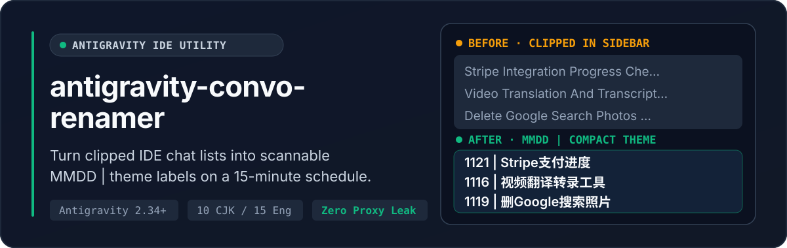
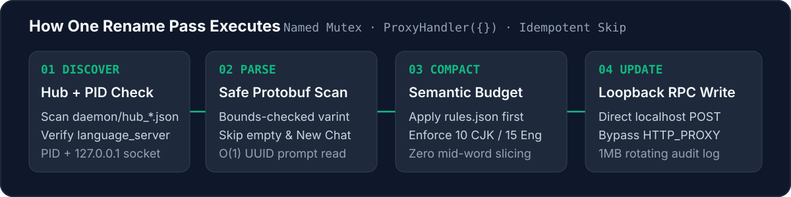

<p align="center">
  
</p>

# antigravity-convo-renamer

Keep your Antigravity IDE conversation sidebar readable. This utility automatically formats chat titles into date-prefixed, compact summaries (`MMDD｜<theme>`) within **10 Chinese characters (20 display units) or 15 ASCII characters**, and runs silently every 15 minutes via Windows Task Scheduler.

---

## Why This Exists

Antigravity generates multi-word English titles (`Project Architecture Review And Enhancement`, `Stripe Integration Progress Check`, `Delete Google Search Photos`) that clip behind timestamps in the narrow left sidebar.

| Raw IDE Title | Sidebar Before | Formatted After |
| :--- | :--- | :--- |
| `Stripe Integration Progress Check` | `Stripe Integration Progress Che...` | `1121｜Stripe支付进度` |
| `Video Translation And Transcription Tools` | `Video Translation And Transcript...` | `1116｜视频翻译转录工具` |
| `Delete Google Search Photos` | `Delete Google Search Photos ...` | `1119｜删Google搜索照片` |
| `Project Architecture Review And Enhancement` | `Project Architecture Review And ...` | `1122｜项目架构审查完善` |
| `Unknown Library Migration Guide` | `Unknown Library Migration Guid...` | `1122｜Unknown Library` |

Instead of truncating mid-word, the compaction engine:
- Preserves clean full translations first using phrase-longest-match semantics.
- Rejects half-translated Chinglish fragments and falls back cleanly to word-boundary-compacted English (`<= 15` chars).
- Respects optional per-workspace rules (`rules.json`) for coursework, sprints, or client prefixes without modifying source code.

---

## How It Works

<p align="center">
  
</p>

1. **Antigravity 2.34+ Daemon Discovery**: Starting in Antigravity `2.34.0`, `language_server.exe` stopped passing `--csrf_token` on the command line and moved endpoint discovery to `~/.gemini/antigravity/daemon/hub_*.json`. The renamer inspects `hub_*.json` newest-first (with legacy CLI fallback), verifies the PID is alive and is `language_server`, confirms the port is listening on loopback (`127.0.0.1` / `::1`), and probes `GetAllCascadeTrajectories`.
2. **Proxy-Free Localhost RPC**: Uses `urllib.request.ProxyHandler({})` so local proxy tools (`HTTP_PROXY` / `HTTPS_PROXY` / WinINET) cannot intercept localhost requests or capture `x-codeium-csrf-token`.
3. **Bounds-Checked Protobuf Reader**: Safely reads `~/.gemini/antigravity/agyhub_summaries_proto.pb` with 64-bit varint overflow checks and wire-type validation, skipping placeholder chats (`New Conversation`, `New Chat`, subagent empty titles).
4. **Silent Background Scheduling**: `scripts/run_silent.vbs` runs hidden via `wscript.exe`, waits synchronously to forward real exit codes to Windows Task Scheduler, and uses a Windows Named Mutex (`Local\AntigravityAutoConvoRename`) to block overlapping runs.

---

## Quick Start (Windows)

### 1. Clone and install dependencies

```powershell
git clone https://github.com/Tyleraltight/antigravity-convo-renamer.git
cd antigravity-convo-renamer
pip install -r requirements.txt
```

### 2. Preview with dry-run (recommended first)

No titles are modified when `--dry-run` is passed:

```powershell
.\scripts\run_cli.bat --dry-run
```

Example output:

```text
[DRY-RUN] 'Stripe Integration Progress Check' -> '1121｜Stripe支付进度' (ID: b706d4d6)
[DRY-RUN] 'Project Architecture Review And Enhancement' -> '1122｜项目架构审查完善' (ID: d32c0582)
AutoRename finished (dry_run=True). Renamed: 2, Skipped: 351, OK: True
```

### 3. Run once live or install the 15-minute scheduler

Run once immediately:

```powershell
.\scripts\run_cli.bat
```

Or register the background Windows Task Scheduler job (runs every 15 minutes silently):

```powershell
powershell -ExecutionPolicy Bypass -File .\scripts\install_task.ps1
```

To remove the scheduled task later:

```powershell
powershell -ExecutionPolicy Bypass -File .\scripts\uninstall_task.ps1
```

---

## Custom Workspace Rules & Dictionary (`rules.json`)

Copy `rules.example.json` to `rules.json` (gitignored) to customize timezone, width limits, domain terms, or project-specific naming patterns:

```json
{
  "timezone": "Asia/Shanghai",
  "max_cjk_units": 20,
  "max_eng_chars": 15,
  "tech_allowlist": ["STRIPE", "SUPABASE", "NEXTJS"],
  "custom_translations": {
    "stripe integration progress check": "Stripe支付进度"
  },
  "workspace_rules": [
    {
      "path_contains": "/my-coursework",
      "skip_if_matches": "^(CourseA|Capstone)-[-_A-Za-z0-9]+$",
      "rules": [
        {
          "match_any": ["coursea"],
          "regex_extract": {
            "pattern": "week\\s*(\\d+)",
            "template": "CourseA-W{1}",
            "fallback": "CourseA-Lab"
          }
        }
      ]
    }
  ]
}
```

Pass a custom path anytime with:

```powershell
python renamer.py --config .\my-rules.json --dry-run
```

---

## Logs & Verification

- Rotating logs are written to `~\.gemini\antigravity\logs\auto_rename.log` (`1 MB` x 3 backups).
- Run the unit test suite (`9` tests covering protobuf bounds, stale PID/loopback filtering, proxy bypass, sidebar compaction, custom JSON rules, and Windows mutex re-entrancy):

```powershell
python -m unittest discover -s tests -v
```

---

## Requirements & Compatibility

- Windows 10 / 11 with Antigravity IDE running locally (`2.34+` or legacy `< 2.34`)
- Python `3.11+` (`psutil>=5.9.0`, `tzdata>=2024.1`)

## License

[MIT](./LICENSE)
