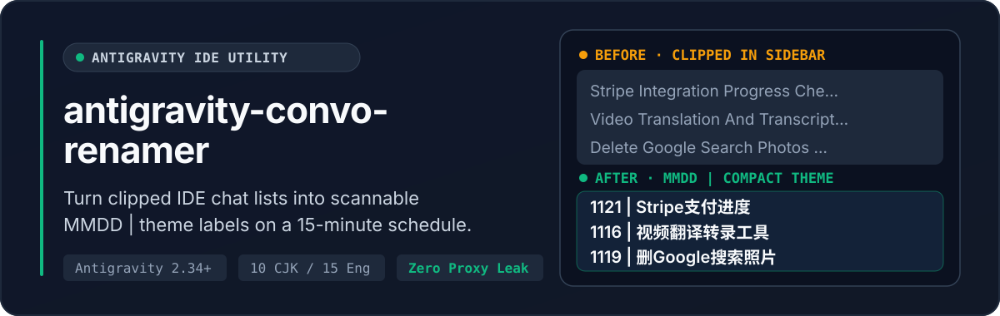
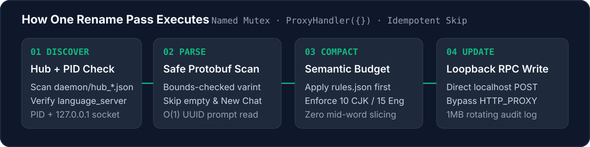

<p align="center">
  
</p>

<p align="center">
  <a href="./README.md">English</a> &nbsp;|&nbsp; <b>简体中文</b>
</p>

# antigravity-convo-renamer

让 Antigravity IDE 左侧会话栏重新变得好读。这个工具会把会话标题统一整理成带日期前缀的精简摘要（`MMDD｜<主题>`），中文不超过 **10 个汉字（20 个半角显示单位）**，纯英文不超过 **15 个字符**，并通过 Windows 任务计划程序每 15 分钟静默运行一次。

---

## 为什么需要它

Antigravity 自动生成的英文标题往往很长（`Project Architecture Review And Enhancement`、`Stripe Integration Progress Check`、`Delete Google Search Photos`），在狭窄的侧边栏里会被时间戳挤掉后半截。

| IDE 原始标题 | 整理前（侧边栏） | 整理后 |
| :--- | :--- | :--- |
| `Stripe Integration Progress Check` | `Stripe Integration Progress Che...` | `1121｜Stripe支付进度` |
| `Video Translation And Transcription Tools` | `Video Translation And Transcript...` | `1116｜视频翻译转录工具` |
| `Delete Google Search Photos` | `Delete Google Search Photos ...` | `1119｜删Google搜索照片` |
| `Project Architecture Review And Enhancement` | `Project Architecture Review And ...` | `1122｜项目架构审查完善` |
| `Unknown Library Migration Guide` | `Unknown Library Migration Guid...` | `1122｜Unknown Library` |

压缩时不会在单词中间硬截断，而是按下面的顺序处理：
- 先用"最长短语优先"的词表做完整翻译。
- 翻译不完整、会产生中英混杂碎片时，放弃翻译，改为按词边界压缩后的英文（不超过 15 个字符）。
- 支持可选的按工作区规则文件 `rules.json`，用于课程、迭代、客户前缀等场景，无需改动源码。

---

## 工作原理

<p align="center">
  
</p>

1. **Antigravity 2.34+ 服务发现**：自 Antigravity `2.34.0` 起，`language_server.exe` 不再通过命令行传递 `--csrf_token`，端点信息改为写入 `~/.gemini/antigravity/daemon/hub_*.json`。本工具按修改时间从新到旧读取 `hub_*.json`（保留旧版命令行兜底），校验 PID 存活且进程名为 `language_server`，确认端口只监听在回环地址（`127.0.0.1` / `::1`），再探测 `GetAllCascadeTrajectories` 是否可用。
2. **绕过代理的本地 RPC**：使用 `urllib.request.ProxyHandler({})`，本机代理工具（`HTTP_PROXY` / `HTTPS_PROXY` / WinINET）无法拦截发往本地的请求，也就拿不到 `x-codeium-csrf-token`。
3. **带边界检查的 Protobuf 读取**：读取 `~/.gemini/antigravity/agyhub_summaries_proto.pb` 时校验 64 位 varint 溢出与 wire type，并跳过占位会话（`New Conversation`、`New Chat`、子代理空标题）。
4. **静默后台调度**：`scripts/run_silent.vbs` 通过 `wscript.exe` 隐藏运行，同步等待并把真实退出码回传给任务计划程序；同时用 Windows 命名互斥量（`Local\AntigravityAutoConvoRename`）阻止多个实例重叠运行。

---

## 快速开始（Windows）

### 1. 克隆并安装依赖

```powershell
git clone https://github.com/Tyleraltight/antigravity-convo-renamer.git
cd antigravity-convo-renamer
pip install -r requirements.txt
```

### 2. 先用 dry-run 预览（推荐）

加上 `--dry-run` 不会修改任何标题：

```powershell
.\scripts\run_cli.bat --dry-run
```

输出示例：

```text
[DRY-RUN] 'Stripe Integration Progress Check' -> '1121｜Stripe支付进度' (ID: b706d4d6)
[DRY-RUN] 'Project Architecture Review And Enhancement' -> '1122｜项目架构审查完善' (ID: d32c0582)
AutoRename finished (dry_run=True). Renamed: 2, Skipped: 351, OK: True
```

### 3. 立即执行一次，或安装 15 分钟定时任务

立即执行一次：

```powershell
.\scripts\run_cli.bat
```

注册后台 Windows 计划任务（每 15 分钟静默运行）：

```powershell
powershell -ExecutionPolicy Bypass -File .\scripts\install_task.ps1
```

之后需要卸载时：

```powershell
powershell -ExecutionPolicy Bypass -File .\scripts\uninstall_task.ps1
```

---

## 自定义工作区规则与词表（`rules.json`）

把 `rules.example.json` 复制为 `rules.json`（已被 gitignore），即可自定义时区、宽度上限、领域术语或按项目归类的命名规则：

```json
{
  "timezone": "Asia/Shanghai",
  "max_cjk_units": 20,
  "max_eng_chars": 15,
  "tech_allowlist": ["STRIPE", "SUPABASE", "NEXTJS"],
  "custom_translations": {
    "stripe integration progress check": "Stripe支付进度"
  },
  "workspace_rules": [
    {
      "path_contains": "/my-coursework",
      "skip_if_matches": "^(CourseA|Capstone)-[-_A-Za-z0-9]+$",
      "rules": [
        {
          "match_any": ["coursea"],
          "regex_extract": {
            "pattern": "week\\s*(\\d+)",
            "template": "CourseA-W{1}",
            "fallback": "CourseA-Lab"
          }
        }
      ]
    }
  ]
}
```

也可以随时指定自定义路径：

```powershell
python renamer.py --config .\my-rules.json --dry-run
```

---

## 日志与验证

- 滚动日志写入 `~\.gemini\antigravity\logs\auto_rename.log`（单文件 `1 MB`，保留 3 份备份）。
- 运行单元测试（共 `9` 项，覆盖 Protobuf 边界、陈旧 PID 与非回环端口过滤、代理绕过、侧边栏压缩、自定义 JSON 规则、Windows 互斥量防重入）：

```powershell
python -m unittest discover -s tests -v
```

---

## 环境与兼容性

- Windows 10 / 11，本机运行 Antigravity IDE（`2.34+` 或更早版本）
- Python `3.11+`（`psutil>=5.9.0`、`tzdata>=2024.1`）

## 许可证

[MIT](./LICENSE)
